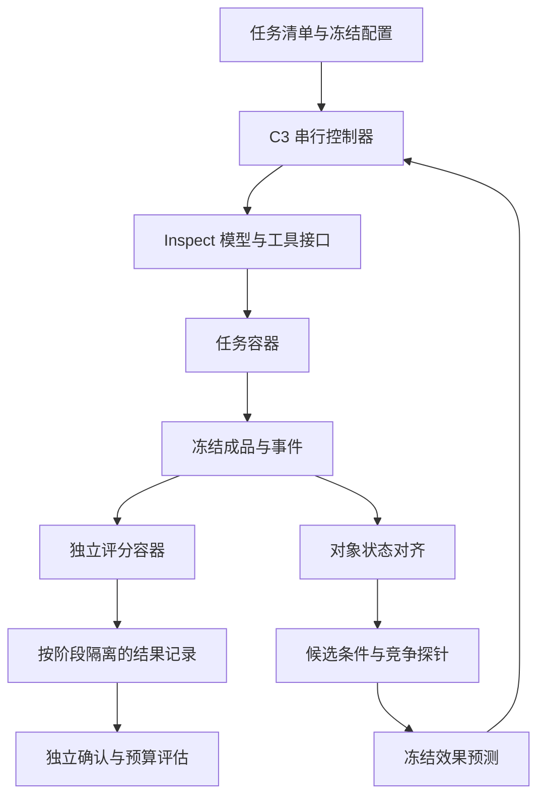

# C3 架构与开源复用决议

日期：2026-10-10。范围：本机 ARM64、串行工程底座；当前没有完成真实模型干预验证。

本文件保留初版架构决议；当前接口冻结及进度以 [C3-E2 Protocol v1.0](C3_E2_PROTOCOL_v1_0.md) 和 [D1–D5 验收](E2_D1_D5_ACCEPTANCE.md) 为准。

## 1. 选型结论

采用 **Inspect AI + Docker Compose + C3 研究层**。新项目独立于历史审计包，旧轨迹只作为开发与兼容适配材料。核心研究数据结构与证据存储保持标准库实现，Inspect 通过适配层接入。

| 项目 | 已核对的能力 | 本项目的采用方式 |
|---|---|---|
| [Inspect AI](https://inspect.aisi.org.uk/sandboxing.html)，MIT | 模型接口、任务/solver/scorer、Docker 沙盒、命名环境、日志及并发控制 | 第一版执行底座；固定 `inspect-ai==0.3.278` |
| [Harbor](https://github.com/harbor-framework/harbor)，Apache-2.0 | 标准任务目录、Agent 适配、容器生命周期、轨迹；可选独立 verifier | 参考任务封装与独立评分，未来按需要加适配器；不同时引入第二套执行调度 |
| [OpenHands SDK](https://github.com/OpenHands/software-agent-sdk)，MIT | Agent/工具接口、事件、会话分叉、Docker workspace | 后续作为被测 Agent 接入；会话分叉本身不保证文件回滚 |

Inspect 指定 Docker 沙盒并不会使所有 Python 代码自动在容器内执行。控制器与模型调用仍在宿主侧，只有显式发往 sandbox 的工具操作在容器内执行。本项目利用这个边界，将凭据、证据记录和隐藏评分材料留在任务 Agent 的权限之外。[Inspect 沙盒说明](https://inspect.aisi.org.uk/sandboxing.html)

Harbor 的独立评分需显式配置，不能假设默认启用。[独立 verifier 设计](https://github.com/harbor-framework/harbor/blob/09f5b964f8e5075f7e52fd08c9994dfc80ad5d24/docs-mintlify/tasks/separate-verifier.mdx)

Inspect 的原生 Agent checkpoint 文档目前标为开发版本能力，且不恢复进程内存、后台服务和外部副作用。第一版不依赖未发布接口；当前实现只提供明确声明范围的文件快照。后续可以复用其存储与恢复机制，但仍需 C3 自己验收状态充分性。[checkpoint 文档](https://inspect.aisi.org.uk/checkpointing.html)

## 2. 责任与信任边界

图中的对齐、主动选择、真实分支恢复与确认评估是完整目标架构，不表示这些研究算法已经实现。已实现范围见 README 能力表。

### 可信控制器

持有 Docker 管理接口、模型凭据、任务/探针版本、对话前缀、事件、成本以及评分调度。它不执行 Agent 提议的宿主 shell 命令。任务生成、冻结与实验选择必须通过有记录的接口。

### 任务容器

普通用户，根文件系统只读，无网络、无额外 capabilities，无宿主目录和 Docker socket 挂载。工作区及临时目录是该样本独有的可写状态。CPU、内存与进程数显式受限。Agent 只能获得当前阶段允许的任务与探针内容。

### 评分容器

检查器和隐藏参考烘焙进独立镜像；不向任务容器复制。控制器仅传递允许的冻结成品，评分输出严格解析。不可因为脚本退出码为零、缺失字段或无法解析 JSON 就判通过。当前工程 smoke 使用微型 JSON 任务，不声称已接入 OfficeVal 官方 verifier。

### 数据隔离

`development`、`exploration`、`confirmation` 是不同角色的数据域。目录分开只是组织形式，真实确认实验必须由控制器落实访问限制；当前结构不能声称已实现强隔离的盲评服务。确认结果不得回传给自适应选择器，模型输出中的提示不赋予额外文件或网络权限。

## 3. 模块合同

| 模块 | 输入 → 输出 | 实现边界 |
|---|---|---|
| 配置与计划 | JSON 配置 → 验证结果、运行计划、阻塞项 | 并发固定为 1，真实实验需单独满足就绪条件 |
| 任务适配 | 公开任务、资产版本 → CaseSpec | OfficeVal 接入需拆分公开资产与隐藏 rubric |
| 执行适配 | 消息/工具请求 → 观察、耗时、模型用量 | Inspect 对接；smoke 使用脚本夹具，没有真实模型调用 |
| 状态与证据 | 工作区 → 文件清单、内容哈希、恢复核验 | 已实现普通文件/目录的有限合同；拒绝软链接与特殊文件 |
| 对象级对齐 | 两组对象状态与操作 → 候选转换 | 待实现；不以 Shell 文本差异替代 |
| 探针库 | 候选条件与权限 → 探针/对照/泄漏审查 | 待冻结；不允许正确补丁或成功轨迹注入执行 Agent |
| 预测登记 | 相同候选全集概率 → 不可覆盖记录 | 内容哈希用于完整性；不等于第三方时间戳或预注册 |
| 分支控制 | 文件状态、精确对话前缀、配置、探针 → 分支记录 | 真实模型分支待实现；错误恢复必须阻断 |
| 评分与成本 | 冻结成品、参考 → 严格结果与分项成本 | smoke 已有独立 grader；正式约束和完整成本待接入 |
| 分析与迁移 | 封存结果 → Brier/LogLoss/差异/区间 | 待实现；不生成示意性的“实验优势”数值 |

## 4. 历史代码的复用边界

`Agent_Latent_Capability_Audit_Kit` 不作为新运行时依赖。后续可适配任务 ID、公开任务描述、官方 verifier 输出模型、旧 JSONL 读取器及模型接口。

以下实现不进入新真实实验路径：基于 `cwd`/正则的宿主执行器；只存部分文件哈希的旧检查点；核验失败后仍执行的旧重放器；按实验臂返回预写修复的脚本；名称包含 LLM 但只运行规则的诊断器。

旧 SafeFix 的“出现一个新加分项”也不能自动复用为新主终点；新协议区分错误预防、目标缺陷消除与保护约束。

## 5. 推进顺序与完成定义

1. 当前：配置/证据合同、快照、预测冻结、Inspect/Docker 工程 smoke。
2. 下一步：离线 OfficeVal 资产清单及独立评分适配；一张完整实验卡。
3. 然后：明确模型、版本、预算，接入真实工具调用与精确对话恢复，验收原始条件重建。
4. 再做：人工 P0 探针预测与对照实验，所有失败和无效探针留档。
5. P0 可行性成立后：实现语义对齐、主动选择及独立 P1/R4 评价。

当前的测试通过只说明限定工程合同成立，不提升任何历史或新科学关卡。
