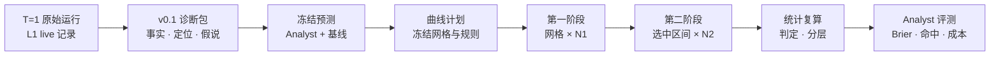

# L2 升级方案 v0.2.1（基于现有代码）

<callout icon="🛠️" color="blue_bg">
	**目标：**L1 只修一处代码，补上显式重试和 T = 1 配置（第 6.1 节）；在此基础上，把 v0.1 已有的 `resume_unchanged` 续跑扩展为**两阶段稀疏价值曲线**：得到可识别的定位结论（E1），并用严格评分规则评测 Analyst。强策略接管和信息注入留到 v0.3。
	**依据：**代码 [agent-diagnosis-framework@0bd756a](https://github.com/GaAs9000/agent-diagnosis-framework/tree/0bd756ab0a8be97393b1ff904970c6399886d73a)；设计见 <mention-page url="https://app.notion.com/p/89a85afaaa2b41388f23ee341306ebe3">L2 · 行为定位（Behavioral Event Localization）</mention-page>。第三节的数字来自合成数据模拟，用来定参数，不是实验结果。
	**v0.2.1 更新：**① 新增 L1 前置修复清单（6.1），其中系统提示截断是真 bug；② 吸收外部评审意见，逐条对照代码核实（第十一节）：未交卷记 0 分、LHTB 改用是否通关作终点、分层标签扩充；③ 第十节的决定已确定；④ 补充执行约束：墙钟预算放宽、显式重试、续跑首请求一致性检查。
</callout>
<table_of_contents color="gray"/>
---
## 一、第一性原理：L2 到底在测什么
L2 的每条结论，最终都要落到一个比较上：**同一个策略、从同一个完整状态出发，在两种可执行的条件下，结果分布是否不同。**只读日志得到的只能是候选假说。由此推出八条约束，逐条对照现有代码：
<table header-row="true">
<tr>
<td>#</td>
<td>**原理**</td>
<td>**推论**</td>
<td>**现有代码**</td>
</tr>
<tr>
<td>1</td>
<td>被诊断的是**策略** π：模型版本、解码参数、系统提示、工具协议、预算规则</td>
<td>所有分支必须来自同一个 π</td>
<td>✅ 冷恢复要求配置完全一致（[orchestrator.py#L95](https://github.com/GaAs9000/agent-diagnosis-framework/blob/0bd756ab0a8be97393b1ff904970c6399886d73a/L1_sandbox/C3_Experimental_Sandbox/src/c3_sandbox/l1/core/orchestrator.py#L95)）。⚠️ 但系统提示构建会截掉配置里预算句之后的内容，实际的 π 与配置不符（[orchestrator.py#L39](https://github.com/GaAs9000/agent-diagnosis-framework/blob/0bd756ab0a8be97393b1ff904970c6399886d73a/L1_sandbox/C3_Experimental_Sandbox/src/c3_sandbox/l1/core/orchestrator.py#L38-L39)），见 6.1 P0-1</td>
</tr>
<tr>
<td>2</td>
<td>检查点必须是**完整状态**：会影响后续的东西都在里面</td>
<td>读档后的未来分布与原运行一致</td>
<td>✅ 每次工具调用都新建只读根容器、无网络；/tmp、进程、环境变量都不保留，只有 /workspace 持久（[docker.py#L77-L82](https://github.com/GaAs9000/agent-diagnosis-framework/blob/0bd756ab0a8be97393b1ff904970c6399886d73a/L1_sandbox/C3_Experimental_Sandbox/src/c3_sandbox/l1/runtime/docker.py#L77-L82)）。所以「工作区 + 原生对话 + 待返回观察 + 预算计数」就是完整状态</td>
</tr>
<tr>
<td>3</td>
<td>「另一种做法」来自**策略自身的采样**</td>
<td>temperature = 0 时没有可比较的分布，$`\Delta V`$ 退化为 0</td>
<td>❌ 所有 L1 配置都是 `temperature: 0`。Gemini 3 官方也强烈建议保持默认值 1.0，调低可能出现循环或性能下降（[Gemini 3 开发者指南](https://ai.google.dev/gemini-api/docs/gemini-3)）</td>
</tr>
<tr>
<td>4</td>
<td>结果由官方评分器从终态算出</td>
<td>$`V(c_k)`$ 是终点的期望；守恒式 $`\sum_k \Delta V_k = Y - V(c_0)`$ 对任何有界终点都成立</td>
<td>🟡 评分器是否确定，需要在 M3.0 验证</td>
</tr>
<tr>
<td>5</td>
<td>不加新的干预接口，也有两类**可识别对比**</td>
<td>① 跨检查点：$`V(c_j) - V(c_i)`$ 衡量这一段实际执行的作用（定位）；② 同一检查点内，按第一个重采样回合的动作类别分组（行为层证据，见第四节）</td>
<td>🟡 `resume_unchanged` 已能产生数据，但只支持单个检查点、只做描述统计（[controller.py#L96-L111](https://github.com/GaAs9000/agent-diagnosis-framework/blob/0bd756ab0a8be97393b1ff904970c6399886d73a/L2_Behavioral%20Event%20Localization/L2_Sandbox/src/l2_sandbox/experiments/controller.py#L96-L111)）</td>
</tr>
<tr>
<td>6</td>
<td>只分析失败轨迹时，实际路径**每一步都略差于平均**</td>
<td>定位的零假设不能是「没有下跌」，而应是「损失均匀摊在每一步」</td>
<td>❌ 未实现</td>
</tr>
<tr>
<td>7</td>
<td>Analyst 是 $`V`$ 的**廉价预测器**</td>
<td>直接用分支结果给预测打分（严格评分规则），不需要人工真值</td>
<td>🟡 已有预测冻结（[pipeline.py#L82](https://github.com/GaAs9000/agent-diagnosis-framework/blob/0bd756ab0a8be97393b1ff904970c6399886d73a/L2_Behavioral%20Event%20Localization/L2_Sandbox/src/l2_sandbox/pipeline.py#L82)）和 `brier()`（[metrics.py#L27](https://github.com/GaAs9000/agent-diagnosis-framework/blob/0bd756ab0a8be97393b1ff904970c6399886d73a/L2_Behavioral%20Event%20Localization/L2_Sandbox/src/l2_sandbox/evaluation/metrics.py#L27)），但 Analyst 不输出价值预测</td>
</tr>
<tr>
<td>8</td>
<td>独立重复的单位是**任务家族**</td>
<td>泛化结论需要多个家族</td>
<td>❌ 现有 9 条记录同属 OfficeVal003 一个家族（[RESEARCH_PROTOCOL.md](https://github.com/GaAs9000/agent-diagnosis-framework/blob/0bd756ab0a8be97393b1ff904970c6399886d73a/L2_Behavioral%20Event%20Localization/L2_Sandbox/docs/RESEARCH_PROTOCOL.md)）</td>
</tr>
</table>
<callout icon="🧭" color="gray_bg">
	**两处对之前判断的修正**
	- **原理 1**：之前把「续跑必须同配置」看成障碍。其实它正是 $`V_{\text{self}}`$ 成立的保证，只挡住了 $`V_{\text{strong}}`$。
	- **原理 6**：对失败轨迹，即使不存在「关键一步」，相邻检查点也会平均下跌约 $`V(c_0)/T`$。判定要和「均匀摊派」比，而不是和 0 比。
</callout>
---
## 二、v0.2 范围
<table header-row="true">
<tr>
<td></td>
<td>**内容**</td>
<td>**依据**</td>
</tr>
<tr>
<td>**做**</td>
<td>在 T = 1 下重跑原始轨迹，测基线成功率</td>
<td>原理 3</td>
</tr>
<tr>
<td>**做**</td>
<td>两阶段稀疏价值曲线（只用 $`V_{\text{self}}`$），按区间或单回合报告定位</td>
<td>原理 5①，不需要 L1 新接口</td>
</tr>
<tr>
<td>**做**</td>
<td>同状态行为分层对比（探索性）</td>
<td>原理 5②，复用第二阶段的分支，不额外花钱</td>
</tr>
<tr>
<td>**做**</td>
<td>Analyst 输出价值预测，用严格评分规则与基线比较</td>
<td>原理 7</td>
</tr>
<tr>
<td>**做**</td>
<td>统计模块、完整性校验扩展、M3.0 保真度检查</td>
<td>原理 4、6</td>
</tr>
<tr>
<td>**做**</td>
<td>L1 前置修复：系统提示截断、显式重试、T = 1 配置、任务扩充、批量采集脚本</td>
<td>原理 1、3，第 6.1 节</td>
</tr>
<tr>
<td>留到 v0.3</td>
<td>$`V_{\text{strong}}`$、状态级不可逆点、「怀疑任务」判定</td>
<td>需要 L1 提供「换策略续跑」接口，并把配置差异写进 lineage</td>
</tr>
<tr>
<td>留到 v0.3</td>
<td>信息注入、动作替换、安慰剂对照（E2）</td>
<td>需要经过审计的 L1 注入接口</td>
</tr>
<tr>
<td>不做</td>
<td>进程热恢复</td>
<td>L1 的运行时本来就不需要（原理 2）</td>
</tr>
</table>

---
## 三、两阶段稀疏价值曲线
### 3.1 记号对齐
- L1 在开局时、以及每个模型回合的全部工具调用执行完后，各存一个检查点：`cp000000`、`cp000001`……（[orchestrator.py#L138-L160](https://github.com/GaAs9000/agent-diagnosis-framework/blob/0bd756ab0a8be97393b1ff904970c6399886d73a/L1_sandbox/C3_Experimental_Sandbox/src/c3_sandbox/l1/core/orchestrator.py#L138-L160)）。记 $`c_j`$ 为 `cp{j:06d}`：已完成 j 个模型回合，下一回合还没采样。
- 从 $`c_j`$ 续跑，会重新采样第 j+1 个回合及之后的全部内容。终态的价值就是 $`Y`$，不需要续跑。
- 区间损失 $`D_{[i,j]} = V(c_i) - V(c_j)`$，单回合损失 $`d_j = V(c_{j-1}) - V(c_j)`$。
- 定位最细到一个模型回合，同一回合里的多次工具调用不再细分。网格只用合格检查点；接近预算上限的检查点可能不合格。
- 续跑时请求编号接着父轨迹往下数：从 $`c_j`$ 续跑的第一个请求，与父轨迹在 $`c_j`$ 之后的那个请求编号相同（`raw/model/r{k}/request.json`，k 为检查点时已用的请求数）。检查点存的是接收完工具结果之后的对话，所以两者的请求体应当逐字节相同（[orchestrator.py#L245-L249](https://github.com/GaAs9000/agent-diagnosis-framework/blob/0bd756ab0a8be97393b1ff904970c6399886d73a/L1_sandbox/C3_Experimental_Sandbox/src/c3_sandbox/l1/core/orchestrator.py#L245-L249)、[#L327-L328](https://github.com/GaAs9000/agent-diagnosis-framework/blob/0bd756ab0a8be97393b1ff904970c6399886d73a/L1_sandbox/C3_Experimental_Sandbox/src/c3_sandbox/l1/core/orchestrator.py#L327-L328)）。这是「同一策略、同一状态」最直接的可检验形式，L2 对每个分支都检查（3.5 节）。
### 3.2 算法
```python
def value_curve(parent, plan):
    T, Y = parent.num_turns, parent.outcome           # 终态价值就是 Y
    grid = list(range(0, T, plan.stride)) + [T]        # 第一阶段网格：固定步长，与 Analyst 无关

    # ① 第一阶段：每个网格点 N1 次续跑，只用来选区间
    s1 = {k: resume(parent, k, plan.N1) for k in grid[:-1]}
    v1 = lambda k: Y if k == T else mean(s1[k])
    a, b = max(pairwise(grid), key=lambda ab: v1(ab[0]) - v1(ab[1]))   # 并列取最早

    # ② 第二阶段：选中区间内每个检查点都用全新的 N2 次续跑（含两端）
    s2 = {k: resume(parent, k, plan.N2) for k in range(a, b + 1) if k < T}

    # ③ 推断只用第二阶段样本（样本拆分，避免「先挑最大再检验」的偏差）
    share = (b - a) / T * (v1(0) - Y)                  # 均匀摊派时这一段应有的损失
    interval_ok = lower_bound(drop(s2, a, b), plan.alpha) > share
    j = argmax_turn_drop(s2, a, b)
    delta_turn = max(0.10, 2 * v1(0) / T)              # 至少是均匀摊派的 2 倍
    turn_ok = lower_bound(drop(s2, j - 1, j), plan.alpha / (b - a)) > delta_turn
    return verdict(interval_ok, turn_ok, (a, b), j, missing_bounds(s1, s2))
```
`lower_bound` 对布尔终点用单侧 Newcombe 区间，对有界得分用 t 或 bootstrap 区间；端点是终态时按单样本处理。
### 3.3 判定（替换原设计的 `Verdict` 枚举）
<table header-row="true">
<tr>
<td>**曲线判定**</td>
<td>**条件**</td>
<td>**对应 v0.1 字段**</td>
</tr>
<tr>
<td>`concentrated_turn`</td>
<td>单回合检验通过</td>
<td>EventLocalization `granularity: event`，证据等级 E1</td>
</tr>
<tr>
<td>`concentrated_interval`</td>
<td>区间检验通过，单回合未通过</td>
<td>`granularity: interval`，E1</td>
</tr>
<tr>
<td>`diffuse_loss`</td>
<td>两项都未通过，且 $`\hat V(c_0)`$ 明显高于 $`Y`$</td>
<td>渐进退化，不指定单点</td>
</tr>
<tr>
<td>`out_of_reach`</td>
<td>$`V(c_0)`$ 的单侧 95% 上界 \< 0.25</td>
<td>没有可分摊的损失，交给 L3</td>
</tr>
<tr>
<td>`not_identifiable`</td>
<td>缺失结果的上下界会改变判定，或采样退化，或网格含不合格检查点</td>
<td>沿用 `not_identifiable`</td>
</tr>
</table>
v0.2 只处理失败轨迹；成功轨迹的「关键突破」是对称情形，之后再加。
### 3.4 参数：模拟结果
合成设定：T = 16，$`V(c_0) = 0.7`$；随机一个回合骤降 Δ，其余损失均匀摊到其他回合；布尔终点；每种设定重复 4,000 次；单回合门槛 0.10。「正确率」三列数字依次对应 Δ = 0.3 / 0.4 / 0.5，「误报」两列数字依次对应区间判定 / 单回合判定。
<table header-row="true">
<tr>
<td>**设计**</td>
<td>**分支数 / 轨迹**</td>
<td>**Agent 回合数 / 轨迹**</td>
<td>**区间判定正确率**</td>
<td>**单回合判定正确率**</td>
<td>**只有均匀损失时的误报**</td>
</tr>
<tr>
<td>两阶段 N1 = 12，N2 = 16</td>
<td>≈ 125</td>
<td>≈ 1,200</td>
<td>0.28 / 0.51 / 0.73</td>
<td>0.12 / 0.32 / 0.60</td>
<td>4.8% / 1.3%</td>
</tr>
<tr>
<td>**两阶段 N1 = 12，N2 = 24（推荐）**</td>
<td>≈ 165</td>
<td>≈ 1,500</td>
<td>0.37 / 0.60 / 0.83</td>
<td>0.17 / 0.42 / 0.74</td>
<td>6.1% / 1.5%</td>
</tr>
<tr>
<td>两阶段 N1 = 16，N2 = 32</td>
<td>≈ 220</td>
<td>≈ 2,000</td>
<td>0.43 / 0.73 / 0.91</td>
<td>0.23 / 0.57 / 0.87</td>
<td>5.8% / 1.1%</td>
</tr>
<tr>
<td>密集：16 个点 × 8 次</td>
<td>128</td>
<td>≈ 1,100</td>
<td>—</td>
<td>0.01 / 0.04 / 0.08</td>
<td>— / 0.5%</td>
</tr>
</table>
- 同样预算下，两阶段比密集采样强一个数量级：密集方案每点只有 8 次，单回合几乎检不出。
- 0.5 量级的骤降大多能定位到单个回合；0.3–0.4 量级通常只能定位到 4 个回合的区间。**默认按区间报告，单回合检验通过才升级。**
- 均匀损失下区间误报约 5–6%，略高于名义 5%，原因是 $`V(c_0)`$ 用的是估计值。可以接受，也可以把区间检验的 α 收紧到 0.04。
- 这是布尔终点的保守情形。归一化得分方差更小的话，功效会更高；M3.0 / M3.1 实测方差后再定 N。
- 原设计的序贯追加（8 → 16 → 32）与 v0.1 的 `no_adaptive_stopping` 冲突，推断也不干净。两阶段规则在计划里预先写死，第二阶段只用新样本推断，两边都满足。
### 3.5 执行细节
- **时间交错**：每一轮把所有检查点的第 i 次续跑按计划种子打乱后一起提交，避免某个检查点的续跑集中在同一时段，让 API 漂移混进 $`\Delta V`$。这是 v0.1 交替分配（[plans.py#L57](https://github.com/GaAs9000/agent-diagnosis-framework/blob/0bd756ab0a8be97393b1ff904970c6399886d73a/L2_Behavioral%20Event%20Localization/L2_Sandbox/src/l2_sandbox/experiments/plans.py#L57)）在多检查点上的推广。
- **有界并发与限流**：v0.1 串行执行（[controller.py#L65-L72](https://github.com/GaAs9000/agent-diagnosis-framework/blob/0bd756ab0a8be97393b1ff904970c6399886d73a/L2_Behavioral%20Event%20Localization/L2_Sandbox/src/l2_sandbox/experiments/controller.py#L65-L72)）。改为线程池并发，默认 4；M3.0 确认墙钟和本机 Docker 资源不受影响后，可升到 8。另加全局令牌桶，按 API 的每分钟请求数和 token 数限流。每个分支用独立目录，回执按 `trial_id` 校验，而不是按完成顺序。L1 每次运行都新建组件，容器由 Docker 自动命名、用完即删，可以安全并发（[docker.py#L135-L163](https://github.com/GaAs9000/agent-diagnosis-framework/blob/0bd756ab0a8be97393b1ff904970c6399886d73a/L1_sandbox/C3_Experimental_Sandbox/src/c3_sandbox/l1/runtime/docker.py#L135-L163)）。
- **结果判定**：每个分支按下表归为有效结果或缺失。规则预先写进计划，第二、三行单独计数。
<table header-row="true">
<tr>
<td>**情形**</td>
<td>**判定**</td>
<td>**说明**</td>
</tr>
<tr>
<td>Agent 自己结束：主动完成、请求或工具预算用完、协议终止</td>
<td>有效，按评分取值</td>
<td>这是策略的结果</td>
</tr>
<tr>
<td>执行有效，但 `submission/` 为空</td>
<td>有效，记 0（dim1 记 False）</td>
<td>没有交付就是失败。上游评分器此时可能返回非 ok 状态，L1 会把评分记为无效（[officeval.py#L13-L14](https://github.com/GaAs9000/agent-diagnosis-framework/blob/0bd756ab0a8be97393b1ff904970c6399886d73a/L1_sandbox/C3_Experimental_Sandbox/src/c3_sandbox/l1/evaluation/officeval.py#L13-L14)），v0.1 的 `outcome()` 再把它记成缺失（[controller.py#L24](https://github.com/GaAs9000/agent-diagnosis-framework/blob/0bd756ab0a8be97393b1ff904970c6399886d73a/L2_Behavioral%20Event%20Localization/L2_Sandbox/src/l2_sandbox/experiments/controller.py#L24)），必须改</td>
</tr>
<tr>
<td>执行有效，评分器正常返回，但状态不是 ok（交付文件损坏或无法解析）</td>
<td>有效，记 0；敏感性分析里改记缺失</td>
<td>前提是该任务的评分器至少对一个交付正常返回过 ok，M3.1 的运行即可证明</td>
</tr>
<tr>
<td>模型传输失败（显式重试后仍失败）、执行中断</td>
<td>缺失</td>
<td>L1 记为 `execution_validity: invalid`</td>
</tr>
<tr>
<td>评分器异常或没有运行（`official_raw` 为空）、官方结果格式不对</td>
<td>缺失</td>
<td>评分链路的问题，不是策略的结果</td>
</tr>
</table>
- **缺失的处理**：按预先声明的规则最多补跑 2 次，新 trial_id 留痕。同时报告缺失全记 0 和全记 1 的上下界；上下界会改变判定时，记为 `not_identifiable`。
- **首请求一致性**：每个分支的第一个请求体必须与父轨迹同编号的请求体逐字节相同（3.1 节），否则中止该分支并标记 `policy_identity_violation`。
- **模型版本**：每个分支记录返回的 `modelVersion`（L1 已解析，[native.py#L73](https://github.com/GaAs9000/agent-diagnosis-framework/blob/0bd756ab0a8be97393b1ff904970c6399886d73a/L1_sandbox/C3_Experimental_Sandbox/src/c3_sandbox/l1/models/native.py#L73)），中途变化就中止并标记。
- **墙钟预算**：续跑会继承父轨迹在检查点时已用的秒数（[orchestrator.py#L101-L105](https://github.com/GaAs9000/agent-diagnosis-framework/blob/0bd756ab0a8be97393b1ff904970c6399886d73a/L1_sandbox/C3_Experimental_Sandbox/src/c3_sandbox/l1/core/orchestrator.py#L101-L105)），而墙钟时间包含 API 延迟和排队时间。并发一高，分支会比原运行更容易超时结束，后面检查点的价值被系统性压低，看起来像一次骤降。所以新配置把 `wall_time_seconds` 设为 3600，让它基本不触发，预算主要由请求数和工具调用数约束；M3.0 验收墙钟到期 \< 1%。
### 3.6 终点
终点一律读取 L1 已经算好的评分投影（`official_grade.json` 里的 `projection`），L2 不再从 `official_raw` 自己重算。这样也顺带修掉了 `official_normalized_score` 没有截断负分、与 L1 不一致的问题（[controller.py#L29-L33](https://github.com/GaAs9000/agent-diagnosis-framework/blob/0bd756ab0a8be97393b1ff904970c6399886d73a/L2_Behavioral%20Event%20Localization/L2_Sandbox/src/l2_sandbox/experiments/controller.py#L29-L33)）。
<table header-row="true">
<tr>
<td>**Benchmark**</td>
<td>**主终点**</td>
<td>**次终点**</td>
<td>**探索性**</td>
</tr>
<tr>
<td>OfficeVal</td>
<td>`official_completion_rate`，即 `projection.completion_rate`：dim1 不通过记 0，通过记 max(0, total) / max（[officeval.py#L25](https://github.com/GaAs9000/agent-diagnosis-framework/blob/0bd756ab0a8be97393b1ff904970c6399886d73a/L1_sandbox/C3_Experimental_Sandbox/src/c3_sandbox/l1/evaluation/officeval.py#L25)）</td>
<td>`official_dim1`（布尔），用于 Brier 评分</td>
<td>dim2 各评分项的 `hit`，画分项价值曲线</td>
</tr>
<tr>
<td>LHTB</td>
<td>`passed`，即 `projection.official_dimensions.passed`（band ≥ 1，布尔）</td>
<td>—</td>
<td>`raw_reward`</td>
</tr>
</table>
- **LHTB 不能用 ****`completion_rate`**：它取的是带步数惩罚的 `reward`，与是否通关分开记录（[lhtb.py#L23-L36](https://github.com/GaAs9000/agent-diagnosis-framework/blob/0bd756ab0a8be97393b1ff904970c6399886d73a/L1_sandbox/C3_Experimental_Sandbox/src/c3_sandbox/l1/evaluation/lhtb.py#L23-L36)）。在这个尺度上，0.10 的单回合门槛基本不可能达到。
- **分项价值曲线**回答「哪一步丢了哪一项要求」，不额外花 API 预算。评分项多，要做 Holm 校正；评分项内容不进入 Analyst 视图，v0.1 的 `private_rubric_injection: false` 保持不变。
- OfficeVal 主终点是有界得分，方差通常小于布尔终点，所以第 3.4 节的模拟是保守情形；M3.0 实测方差后可重算功效。
---
## 四、同状态行为分层：不注入也能得到的行为层证据
第二阶段在 $`c_{j-1}`$ 上已经有 N2 条分支，每条都重新采样了第 j 个回合。按这个回合的动作类别 B（用预先声明的 L2a 规则判定）分组，比较：
$$
\Delta_B = \mathbb{E}[Y \mid c_{j-1},\ a_j \in B] - \mathbb{E}[Y \mid c_{j-1},\ a_j \notin B]
$$
- **为什么可识别**：给定完整状态，第 j 回合的动作只由策略自己的采样决定，没有别的混杂。所以 $`\Delta_B`$ 就是两种策略的结果差：第 j 回合只在 B 类（或非 B 类）动作里采样，之后照常执行。
- **能说什么**：「在这个状态下，Agent 采取 B 类动作时，成功率低 x」。**不能说**「B 本身导致失败」，因为 B 类动作可能在其他方面也不同（比如整体计划更草率）。证据等级记为 **E1+**，介于定位（E1）和干预验证（E2）之间。
**分层标签**：只看第 j 回合本身，不看之后的行为（之后的行为是结果的一部分）；在 Analyst 的假说和曲线计划里预先冻结。
<table header-row="true">
<tr>
<td>**标签**</td>
<td>**定义**</td>
<td>**来源（L2a 事实）**</td>
<td>**适用范围**</td>
</tr>
<tr>
<td>`tool_execution_anomaly`</td>
<td>本回合有工具调用非零退出或超时</td>
<td>`tool_exit`</td>
<td>全部任务</td>
</tr>
<tr>
<td>`submission_modified`</td>
<td>本回合改动了 `/workspace/submission/` 下的文件</td>
<td>`file_transition`</td>
<td>全部任务</td>
</tr>
<tr>
<td>`assistant_finished_turn`</td>
<td>本回合不再调用工具，直接结束</td>
<td>`tool_requested`、`termination`</td>
<td>全部任务</td>
</tr>
<tr>
<td>`submission_readback`</td>
<td>本回合读取了 `submission/`，但没有改动它</td>
<td>`tool_requested` 和 `file_transition`（启发式：命令里出现 submission 路径，且本回合该目录没有变化）</td>
<td>全部任务</td>
</tr>
<tr>
<td>`object_structure_changed`</td>
<td>本回合引起文档对象结构变化</td>
<td>`object_structure_change`</td>
<td>仅 .docx 任务（L2a 目前只有 docx 探针，[build.py#L143-L152](https://github.com/GaAs9000/agent-diagnosis-framework/blob/0bd756ab0a8be97393b1ff904970c6399886d73a/L2_Behavioral%20Event%20Localization/L2_Sandbox/src/l2_sandbox/facts/build.py#L143-L152)）；其他任务记为不适用</td>
</tr>
</table>
- 很多关键错误不会让命令报错，比如脚本把表格结构写坏、退出码仍是 0。所以不能只按 `tool_execution_anomaly` 分层。
- auditspec 的「自称完成 vs 实际状态」在这里落地为：同一状态下，比较 `assistant_finished_turn` 和 `submission_readback` 两类分支，即「不检查直接结束」和「先回读交付物」的结果差。
- 每个标签做一次「B vs 非 B」对比，两类都要出现且每类至少 4 条，否则 `not_identifiable`；多个标签之间做 Holm 校正。
- 单条轨迹样本少，主要做跨轨迹合并（按任务家族分层的 Mantel–Haenszel）。
- **附带指标**：实际回合的类别能解释多少下跌，即 $`\big(V(c_{j-1}) - \mathbb{E}[Y \mid c_{j-1}, a_j \in B_{\text{实际}}]\big) / d_j`$。
---
## 五、Analyst 升级与评测
### 5.1 新增输出
- `value_predictions`：对第一阶段网格上的每个检查点，预测续跑的期望终点（布尔终点给概率）。
- `predicted_loss_intervals`：最多 3 个预测的损失区间或回合，按置信度排序。
- 假说的 `target_behavior`：从固定的 L2a 类别里选，供第四节使用。
- 这些字段在编译曲线计划**之前**冻结进 `predictions/frozen_manifest.json`。计划已经绑定 `prediction_commitment_sha256`（[plans.py#L52](https://github.com/GaAs9000/agent-diagnosis-framework/blob/0bd756ab0a8be97393b1ff904970c6399886d73a/L2_Behavioral%20Event%20Localization/L2_Sandbox/src/l2_sandbox/experiments/plans.py#L52)），只需把新字段纳入摘要。
- Analyst 能看到原始轨迹和原始结果 Y，看不到任何分支结果。是否提供任务基线成功率，作为消融单独报告。
### 5.2 基线（输入相同）
<table header-row="true">
<tr>
<td>**基线**</td>
<td>**预测方式**</td>
<td>**作用**</td>
</tr>
<tr>
<td>常数</td>
<td>所有检查点都预测基线成功率</td>
<td>完全不定位的下限</td>
</tr>
<tr>
<td>**线性衰减**</td>
<td>从基线成功率线性降到 Y</td>
<td>「均匀摊派」零假设，最重要的对照</td>
</tr>
<tr>
<td>首个异常</td>
<td>第一次工具异常之后降到 Y</td>
<td>对应「第一个报错就是原因」的直觉</td>
</tr>
<tr>
<td>rules / structured-once</td>
<td>v0.1 已有</td>
<td>改为也输出价值预测</td>
</tr>
<tr>
<td>原始日志</td>
<td>同一模型直接读原始日志</td>
<td>RESEARCH_PROTOCOL 列了，尚未实现</td>
</tr>
<tr>
<td>随机</td>
<td>随机位置的阶跃</td>
<td>健全性检查</td>
</tr>
</table>
### 5.3 指标
**价值预测误差（主指标）**：直接用每条分支的结果给预测打分，布尔终点用 Brier，得分终点用平方误差。分支结果 $`Y^{(i)}`$ 是从 $`V(c_k)`$ 抽出来的，所以
$$
\mathbb{E}\big[(p - Y^{(i)})^2\big] = \big(p - V(c_k)\big)^2 + V(c_k)\big(1 - V(c_k)\big)
$$
第二项与预测无关。两个方法的 Brier 之差，就是它们离真实 $`V`$ 的平方误差之差的无偏估计。**不需要人工标注真值**，也符合 v0.1「指标需要外部标签，不自动生成因果真值」的原则（[metrics.py#L1](https://github.com/GaAs9000/agent-diagnosis-framework/blob/0bd756ab0a8be97393b1ff904970c6399886d73a/L2_Behavioral%20Event%20Localization/L2_Sandbox/src/l2_sandbox/evaluation/metrics.py#L1)）：分支结果是观测，不是推出来的标签。
- **技能分**：相对线性衰减基线的 Brier 改进比例。
- **定位命中**：复用现有 `localization_metrics`。把判定通过的区间或回合映射成模型回合的事件 ID，作为 `accepted_event_sets`；判定为 `diffuse_loss` 或 `not_identifiable` 的轨迹记为 `gold_undefined_not_scored`，现有函数已支持。
- **成本**：Analyst 的 token 开销与等效续跑次数之比。
- **区间与划分**：按任务家族做聚类 bootstrap；提示词只在训练家族上调，结果只报告留出家族（现有 `family_partition`）。
<callout icon="⚠️" color="yellow_bg">
	**评测用的网格必须与 Analyst 无关。**如果按 Analyst 的预测去加密采样，它预测的地方真值测得更细，评测会偏向它。规模化使用时可以让 Analyst 指导网格，但那批数据不能进评测集。
</callout>
---
## 六、代码改动清单
### 6.1 L1：一处代码修复 + 显式重试 + 配置与数据
**顺序约束**：续跑要求配置完全一致（[orchestrator.py#L95](https://github.com/GaAs9000/agent-diagnosis-framework/blob/0bd756ab0a8be97393b1ff904970c6399886d73a/L1_sandbox/C3_Experimental_Sandbox/src/c3_sandbox/l1/core/orchestrator.py#L95)），而系统提示是在这次比较之前重新构建的（[#L79](https://github.com/GaAs9000/agent-diagnosis-framework/blob/0bd756ab0a8be97393b1ff904970c6399886d73a/L1_sandbox/C3_Experimental_Sandbox/src/c3_sandbox/l1/core/orchestrator.py#L79)）。提示修复、温度、重试、墙钟都会写进 resolved_config。所以**三项 P0 全部完成之后**，才能采集要拿来续跑的父轨迹；采集开始后冻结配置，M3.1 的清单记录 `config_sha256`。旧的 T = 0 轨迹不受影响，仍可按原配置续跑。
<table header-row="true">
<tr>
<td>**优先级**</td>
<td>**问题**</td>
<td>**改法**</td>
<td>**验收**</td>
</tr>
<tr>
<td>**P0-1**</td>
<td>**系统提示被截断（真 bug）**。第 39 行的正则带 DOTALL，会删掉 "You operate under a strict execution budget" 之后的全部内容（[orchestrator.py#L38-L39](https://github.com/GaAs9000/agent-diagnosis-framework/blob/0bd756ab0a8be97393b1ff904970c6399886d73a/L1_sandbox/C3_Experimental_Sandbox/src/c3_sandbox/l1/core/orchestrator.py#L38-L39)）。配置里 "Do not make dozens of exploratory shell calls … conclude promptly" 这段指导语从没发给模型。现有测试用的自定义提示里没有这句话，所以没测出来（[test_recovery_gates_and_contracts.py#L159-L189](https://github.com/GaAs9000/agent-diagnosis-framework/blob/0bd756ab0a8be97393b1ff904970c6399886d73a/L1_sandbox/C3_Experimental_Sandbox/tests/l1_live/test_recovery_gates_and_contracts.py#L159-L189)）</td>
<td>只删预算这一句（代码见下）；构建完成后，如果还残留 `{max_model_requests}` 之类未替换的占位符，抛 `ConfigurationError`</td>
<td>① 用真实配置构建，结果包含这段指导语；② 构建结果再构建一次不变；③ 旧轨迹存下的提示经新函数处理后不变，旧轨迹仍可续跑。三条已在 0bd756a 上验证通过</td>
</tr>
<tr>
<td>**P0-2**</td>
<td>**没有显式重试**。L1 设计上不做 SDK 重试（[http.py#L1](https://github.com/GaAs9000/agent-diagnosis-framework/blob/0bd756ab0a8be97393b1ff904970c6399886d73a/L1_sandbox/C3_Experimental_Sandbox/src/c3_sandbox/l1/models/http.py#L1)），429、5xx、超时会直接结束分支并记为无效（[orchestrator.py#L259-L263](https://github.com/GaAs9000/agent-diagnosis-framework/blob/0bd756ab0a8be97393b1ff904970c6399886d73a/L1_sandbox/C3_Experimental_Sandbox/src/c3_sandbox/l1/core/orchestrator.py#L259-L263)）。分支的请求越多，越容易碰上一次失败；只靠补跑，样本会偏向短分支。单次失败率为 p、每个分支 n 次请求时，分支失败率约 $`1-(1-p)^n`$，p = 0.5%、n = 20 时约 10%</td>
<td>新增 `model.retry`（字段见下）。只对 429、500、502、503、504、连接错误和超时重试；遵守 `Retry-After`，指数退避加抖动。每次尝试单独存回执 `raw/model/rNNNNNN/attempt_KK/`，journal 记 `model.retry`；最后一次的响应仍写在原位置，只解析它。`body_truncated` 不重试。读取用 `config['model'].get('retry')`，缺省为 1 次，旧配置的行为和一致性比较都不变</td>
<td>夹具：先 429 后 200，只接受 1 个响应、留 2 份回执、证据校验通过；连续 4 次 503，记 `model_transport_error`、留 4 份回执；旧配置续跑不受影响</td>
</tr>
<tr>
<td>**P0-3**</td>
<td>**所有配置都是 ****`temperature: 0`**</td>
<td>新增 T = 1 配置模板，OfficeVal、LHTB 各一份（字段见下）</td>
<td>`doctor` 通过；resolved_config 里 temperature = 1.0、没有 seed</td>
</tr>
<tr>
<td>P1-1</td>
<td>**任务太少**。OfficeVal 锁文件只有 003、033、060、070、090 五个任务（[data.lock.json](https://github.com/GaAs9000/agent-diagnosis-framework/blob/0bd756ab0a8be97393b1ff904970c6399886d73a/L1_sandbox/C3_Experimental_Sandbox/benchmarks/officeval/data/data.lock.json)），LHTB 只有 sokoban</td>
<td>用现有命令扩充：`c3-l1 benchmark fetch --config … --task officeval_0XX`（可重复 `--task`），已有本地文件用 `lock-local`（[cli.py#L48-L53](https://github.com/GaAs9000/agent-diagnosis-framework/blob/0bd756ab0a8be97393b1ff904970c6399886d73a/L1_sandbox/C3_Experimental_Sandbox/src/c3_sandbox/l1/cli.py#L48-L53)）。排除 9 个需要 Windows COM 的任务：001、008、019、022、023、030、039、074、081（[adapter.py#L13](https://github.com/GaAs9000/agent-diagnosis-framework/blob/0bd756ab0a8be97393b1ff904970c6399886d73a/L1_sandbox/C3_Experimental_Sandbox/src/c3_sandbox/l1/benchmarks/officeval/adapter.py#L13)）</td>
<td>建议直接锁定全部 91 个 Linux 可用任务，M3.1 再按文件类型 × 操作类别分层选 20–30 个</td>
</tr>
<tr>
<td>P1-2</td>
<td>**没有批量采集父轨迹的工具**</td>
<td>新增 `scripts/l1/run_matrix.py`：任务列表 × 重复次数，有界并发调用现有 `run`，输出 `summary.csv`。字段包括任务、重复号、termination、两类 validity、completion_rate、dim1、请求数、合格检查点数、墙钟、modelVersion、重试次数</td>
<td>M3.1 能直接按「成功 1–4 次、合格检查点 ≥ 8」筛选轨迹</td>
</tr>
<tr>
<td>P2-1</td>
<td>**新克隆跑 ****`tests/l1_live`**** 报 17 个失败、44 个错误**，都是环境原因：依赖不入库的 `runs/integrated-delivery-001/bundle`（[conftest.py#L18](https://github.com/GaAs9000/agent-diagnosis-framework/blob/0bd756ab0a8be97393b1ff904970c6399886d73a/L1_sandbox/C3_Experimental_Sandbox/tests/l1_live/conftest.py#L18)、[.gitignore#L8](https://github.com/GaAs9000/agent-diagnosis-framework/blob/0bd756ab0a8be97393b1ff904970c6399886d73a/L1_sandbox/C3_Experimental_Sandbox/.gitignore#L8)）、`third_party/` 源码和 LHTB / SWE-bench Pro 数据</td>
<td>conftest 里缺文件就 `skip` 并写明原因；注册 `live` 标记</td>
<td>新克隆跑 `tests/l1` 和 `tests/l1_live` 没有失败，缺数据的显示为 skipped</td>
</tr>
<tr>
<td>P2-2</td>
<td>旧的 r1 / r11 / r12 测试缺 `inspect_ai`、`httpx2`</td>
<td>移到 `tests/legacy`，默认不收集；或在 extras 里补依赖</td>
<td>与 v0.2 无关</td>
</tr>
</table>
**P0-1 改法**（`src/c3_sandbox/l1/core/orchestrator.py`）：
```python
# 替换第 39 行：只删预算这一句，不再用 DOTALL 删掉后面的全部内容
clean_base = re.sub(r'You operate under a strict (?:execution )?budget\b.*?\.(?:\s+|$)', '',
                    clean_base).rstrip()

# 在 return 之前：不允许残留未替换的预算占位符
prompt = f"{clean_base}\n\n{contract_block}"
if re.search(r'\{(max_model_requests|max_tool_calls|wall_time_seconds|max_total_tokens)\}', prompt):
    raise ConfigurationError('Unformatted budget placeholder left in system prompt')
return prompt
```
**P0-2、P0-3 的 T = 1 配置**（在 `configs/l1/officeval.gemini-35lite.json` 基础上只改这些字段，LHTB 同理）：
```json
{
  "model": {
    "parameters": {"temperature": 1.0, "maxOutputTokens": 8192},
    "timeout_seconds": 300,
    "retry": {"max_attempts": 4, "retry_on_status": [429, 500, 502, 503, 504],
              "retry_on_transport_error": true, "backoff_seconds": [2, 8, 30],
              "honor_retry_after": true}
  },
  "budget": {"max_model_requests": 35, "max_tool_calls": 50, "wall_time_seconds": 3600}
}
```
- **不设 seed**：固定 seed 会让同一检查点的分支高度相关，而 $`V_{\text{self}}`$ 需要独立样本。
- **`timeout_seconds`**** 放宽到 300**：单次请求超时太短，会系统性地丢掉思考时间长的响应；加了重试后，还会把它们换成短的，样本偏向「快」的回答。M3.0 验收超时 \< 0.5%。
- **墙钟 3600**：理由见 3.5 节。新的墙钟值会写进系统提示的约束块，父轨迹和分支一致，不影响策略同一性。
- `config.py` 在 `ALLOWED['model'] |= {...}` 里加入 `retry`，不放进 `DEFAULTS`，旧配置不会被补字段；`validate()` 检查各字段的类型和范围。
### 6.2 L2
<table header-row="true">
<tr>
<td>**文件**</td>
<td>**改动**</td>
</tr>
<tr>
<td>`experiments/plans.py`</td>
<td>新增模板 `value_curve` 和 `compile_curve_plan()`：校验网格内检查点全部合格、剩余预算 \> 0、配置摘要一致；冻结网格、N1 / N2、α、δ 公式、终点、调度种子、并发上限、补跑上限和分层类别。新增阻塞项 `degenerate_policy_sampling`（显式 temperature ≤ 0.05）、`grid_checkpoint_ineligible`、`value_predictions_missing`（评测模式）</td>
</tr>
<tr>
<td>`experiments/controller.py`</td>
<td>新增 `execute_curve()`：按计划生成 trial（如 `s1_cp000004_007`），有界并发调用 L1 的 `run(cfg, out, parent=…, checkpoint_id=…)`。第一阶段结束后，`derive_stage2()` 按冻结规则确定性地算出第二阶段，封存 `stage2_plan.json` 后再执行。`outcome()` 增加 `official_completion_rate` 和评分项 `hit`，并记录 `modelVersion`、终止类别和第一个回合的行为类别。`outcome()` 改为按 3.5 节的判定表和 3.6 节的终点读取 L1 的 `projection`，废弃 `official_normalized_score`；每个分支做首请求一致性检查；加全局限流</td>
</tr>
<tr>
<td>新增 `stats/`</td>
<td>纯函数、确定性、可复算：`intervals.py`（Wilson、Newcombe、有界得分的 t / bootstrap，固定种子）；`curve.py`（点估计、区间损失、选区间、两类检验、判定）；`strata.py`（分层对比与 MH 合并）；`missing.py`（上下界）。附 `stats_policy_version`</td>
</tr>
<tr>
<td>`analyst/`</td>
<td>`submit_diagnosis` 的 schema 增加 `value_predictions`、`predicted_loss_intervals`、`target_behavior`；新增 `baselines.py`（第 5.2 节）</td>
</tr>
<tr>
<td>`facts/`</td>
<td>新增回合级分层标签（第四节表格）；`object_structure_changed` 对非 .docx 任务输出「不适用」</td>
</tr>
<tr>
<td>`evaluation/metrics.py`</td>
<td>新增 `value_prediction_scores()`（Brier / MSE、技能分、按家族聚类 bootstrap）和 `curve_gold()`（曲线判定 → `accepted_event_sets`）</td>
</tr>
<tr>
<td>`package.py`</td>
<td>新包类型 `value_curve_plan`、`value_curve_execution`、`value_curve_results`。校验时从回执重算全部统计量，与 `results.json` 不一致即失败，沿用 `summarize` 的复算做法</td>
</tr>
<tr>
<td>判定白名单</td>
<td>现在执行包只允许 `untested` / `not_identifiable`（[controller.py#L160](https://github.com/GaAs9000/agent-diagnosis-framework/blob/0bd756ab0a8be97393b1ff904970c6399886d73a/L2_Behavioral%20Event%20Localization/L2_Sandbox/src/l2_sandbox/experiments/controller.py#L160)）。改为：曲线判定和分层结论只能来自 `stats/` 的复算结果，并标明 `evidence_basis: value_curve / resample_stratified`</td>
</tr>
<tr>
<td>`cli.py`</td>
<td>`curve-plan`、`curve-execute --allow-execution --max-concurrency N`、`curve-report`、`eval-values`</td>
</tr>
<tr>
<td>`docs/`</td>
<td>新增 `DESIGN_INPUT_v0.2.md`；RESEARCH_PROTOCOL 写明两类新的可识别对比，并以「预先声明的两阶段规则」替代「不做自适应停止」</td>
</tr>
</table>
冻结计划示例：
```json
{
  "package_kind": "value_curve_plan",
  "template": "value_curve",
  "endpoint": {"name": "official_completion_rate", "source": "l1_projection"},
  "grid": {"rule": "stride", "stride": 4,
           "checkpoints": ["cp000000", "cp000004", "cp000008", "cp000012"],
           "terminal": "exact_parent_grade"},
  "stage1": {"replicates": 12},
  "stage2": {"replicates": 24, "rule": "argmax_interval_drop_earliest_tie"},
  "inference": {"interval_null": "uniform_share", "alpha": 0.05,
                "turn_test": "newcombe_one_sided_bonferroni", "delta_turn": "max(0.10, 2*V0/T)"},
  "schedule": {"order": "block_randomized_per_round", "seed_from": "plan_digest", "max_concurrency": 4},
  "failure_policy": {"agent_termination": "valid_outcome", "empty_submission": "score_zero",
                     "unscorable_submission": "score_zero_sensitivity_missing",
                     "infrastructure_invalid": "missing", "max_replacements": 2,
                     "report": "bounds_missing_as_0_and_1",
                     "policy_identity_check": "first_request_bytes_equal"},
  "strata": {"unit": "first_resampled_turn", "min_per_class": 4, "multiplicity": "holm",
             "kinds": ["tool_execution_anomaly", "submission_modified", "assistant_finished_turn",
                       "submission_readback", "object_structure_changed"]},
  "source_index_sha256": "…", "config_sha256": "…", "prediction_commitment_sha256": "…",
  "stats_policy_version": "0.2.0",
  "plan_state": "frozen"
}
```
### 6.3 测试
- **合成环境**：给 `_test_runner` 写一个已知真实价值曲线的假 L1（每个检查点的成功概率预设，分支结果按固定种子抽样），端到端跑通「计划 → 执行 → 复算 → 评测」。
- **统计校准**（进 CI，固定种子）：均匀损失下区间误报 ≤ 7%、单回合误报 ≤ 2%；N1 = 12、N2 = 24 且 Δ = 0.5 时，单回合正确率 ≥ 0.65。
- **完整性**：篡改回执、回执乱序（应通过）、第二阶段与冻结规则不符、判定无法复算、T = 0 的计划、网格含不合格检查点、评测模式缺价值预测，各有对应测试。
- **结果判定**：`submission/` 为空记 0；有交付文件但评分器返回非 ok 记 0 并打标记；`official_raw` 为空记缺失；LHTB 读 `passed`；负分截断沿用 L1 投影。
- **首请求一致性**：夹具 L1 续跑后，第一个请求体与父轨迹同编号的请求逐字节相同；人为改动一个字节后，检查必须失败。
- **分层标签**：每个标签都有正反例；非 .docx 任务的 `object_structure_changed` 为不适用。
- **回归**：现有 95 项测试保持通过。
---
## 七、里程碑与验收
<table header-row="true">
<tr>
<td>**阶段**</td>
<td>**内容**</td>
<td>**验收标准**</td>
</tr>
<tr>
<td>**M3.0 保真度**</td>
<td>3 个 OfficeVal 任务和 LHTB sokoban，各 2 次 T = 1 原始运行，少量真实续跑</td>
<td>① 同一终态重复评分 3 次结果一致；② 从 3 个检查点真实冷恢复成功（包括 Gemini 3 的 thoughtSignature 回传），且首请求与父轨迹逐字节相同；③ 同一中间检查点续跑 8 次，第一个回合至少出现 2 种不同动作，并用 T = 0 配置做阴性对照；④ 墙钟到期 \< 1%，单次请求超时 \< 0.5%，重试后仍失败的分支 \< 1%；⑤ modelVersion 稳定</td>
</tr>
<tr>
<td>**M3.1 基线**</td>
<td>从 91 个 Linux 可用任务中按文件类型 × 操作类别分层选 20–30 个任务家族，各 5 次 T = 1 运行（`run_matrix.py`）</td>
<td>选出成功 1–4 次、至少 8 个合格检查点的失败轨迹 ≥ 40 条，来自 ≥ 15 个家族</td>
</tr>
<tr>
<td>**M3.2 冻结预测**</td>
<td>Analyst 和全部基线对这些轨迹输出价值预测</td>
<td>冻结清单封存后，才允许编译曲线计划</td>
</tr>
<tr>
<td>**M3.3 价值曲线**</td>
<td>两阶段，N1 = 12、N2 = 24</td>
<td>每条轨迹都有判定；缺失率 \< 5%</td>
</tr>
<tr>
<td>**M3.4 Analyst 评测**</td>
<td>留出家族上的 Brier 技能分、定位命中、成本</td>
<td>结论带按家族聚类的 95% 区间</td>
</tr>
<tr>
<td>**M3.5 行为分层**（探索性）</td>
<td>在集中损失的位置做分层，跨轨迹合并</td>
<td>只报告效应和区间，不升级为 E2</td>
</tr>
<tr>
<td>M4 独立评测</td>
<td>按 RESEARCH_PROTOCOL，在开发中没用过的家族上复现</td>
<td>—</td>
</tr>
</table>
**规模估算**：40 条轨迹 × 约 165 个分支 ≈ 6,600 个分支，约 6 万次模型请求（按 T ≈ 16）。若每个分支平均 3 分钟，并发 4 约 80 小时，并发 8 约 40 小时。API 预算不是瓶颈，瓶颈是本机 Docker 并发和时间；M3.0 实测单个分支的耗时后再定并发。
---
## 八、需要回写到 L2 设计页的改动
1. **前提 3**：写明诊断对象是 T = 1 的策略，并附 Gemini 3 的官方建议。
2. **前提 5 与 9.3**：序贯追加（8 → 16 → 32）改为两阶段样本拆分；判定标准改为「超过均匀摊派」。
3. **第四、五节**：$`V_{\text{strong}}`$、状态级不可逆点、`SUSPECT_TASK` 移到 v0.3。
4. **9.1**：`Verdict` 改为第 3.3 节的曲线判定，新增 E1+（同状态分层）。
5. **9.6 与第十节**：Analyst 主指标改为价值预测的 Brier，新增线性衰减基线。
6. **第十一节**：MVP 改用 OfficeVal，成本表按第 3.4 节更新。
7. **缺失与终点**：写入 3.5 节的结果判定表（未交卷记 0）和 3.6 节按 benchmark 区分的终点。
8. **前提**：注明 L1 的 P0 修复（6.1）完成后才能采集父轨迹，采集开始后冻结配置。
---
## 九、旧分析（auditspec / τ² / AppWorld）的取舍
<table header-row="true">
<tr>
<td>**当时的观点**</td>
<td>**现在**</td>
<td>**落在哪里**</td>
</tr>
<tr>
<td>要重采样，不能冻结 Agent 的决策</td>
<td>✅ 仍成立，即原理 3</td>
<td>T = 1 配置；阻塞项 `degenerate_policy_sampling`</td>
</tr>
<tr>
<td>AppWorld 不保存 shell 变量，检查点不完整</td>
<td>✅ 原则成立，L1 已从设计上解决</td>
<td>原理 2：只有 /workspace 持久</td>
</tr>
<tr>
<td>τ² 的用户模拟器会把自身的随机性混进 V</td>
<td>✅ 原则成立</td>
<td>OfficeVal 没有用户模拟、没有网络，V 的随机性几乎全来自策略，这正是选它的理由</td>
</tr>
<tr>
<td>切点要落在完整的消息边界</td>
<td>✅ 已满足</td>
<td>L1 在回合的工具调用全部完成后存档；L2 读取时检查 `pending_calls` 为空</td>
</tr>
<tr>
<td>按分项要求画价值曲线</td>
<td>✅ 值得做</td>
<td>第 3.6 节，用 OfficeVal 的 dim2 评分项</td>
</tr>
<tr>
<td>auditspec 的前缀一致性检查</td>
<td>🟡 换个形式保留</td>
<td>L1 恢复时已校验哈希；再补终态重复评分（M3.0 ①）和首请求逐字节一致（M3.0 ②）</td>
</tr>
<tr>
<td>auditspec 区分「自称完成」与实际状态变化</td>
<td>✅ 吸收</td>
<td>第四节：同一状态下比较「直接结束」和「先回读交付物」</td>
</tr>
<tr>
<td>单一固定切点、固定流程的 Agent、只有离线适配器</td>
<td>❌ 不再相关</td>
<td>L1 每回合存档，原生工具 Agent，在线运行</td>
</tr>
<tr>
<td>MVP 先在 τ² 上做</td>
<td>❌ 撤回</td>
<td>直接用 OfficeVal</td>
</tr>
</table>
---
## 十、已确定的决定
<table header-row="true">
<tr>
<td>**#**</td>
<td>**决定**</td>
<td>**说明**</td>
</tr>
<tr>
<td>1</td>
<td>诊断对象和主结果都用 **T = 1.0** 的策略</td>
<td>旧 T = 0 数据只作 v0.1 归档和 M3.0 阴性对照</td>
</tr>
<tr>
<td>2</td>
<td>OfficeVal 主终点 `official_completion_rate`，次终点 `official_dim1`，dim2 分项作探索；LHTB 用 `passed`</td>
<td>都读 L1 的 `projection`（3.6 节）</td>
</tr>
<tr>
<td>3</td>
<td>**N1 = 12、N2 = 24**，步长 4</td>
<td>API 预算足够，按推荐值。外部评审建议先用 N2 = 16，只在预算受限时采用；M3.0 实测方差后可再调整</td>
</tr>
<tr>
<td>4</td>
<td>OfficeVal 为主；LHTB sokoban 进入 M3.0 做方法检查</td>
<td>LHTB 只锁定了 1 个任务，不进入按家族的评测</td>
</tr>
<tr>
<td>5</td>
<td>并发默认 4，最高 8，另设 API 限流</td>
<td>墙钟预算放宽后，并发不会改变策略本身（3.5 节）</td>
</tr>
</table>
---
## 十一、外部评审意见的核实
<table header-row="true">
<tr>
<td>**意见**</td>
<td>**核实结果**</td>
<td>**处理**</td>
</tr>
<tr>
<td>未交卷的分支被当成缺失</td>
<td>✅ 代码路径属实：评分状态不是 ok 时，L1 把评分记为无效（[officeval.py#L13-L14](https://github.com/GaAs9000/agent-diagnosis-framework/blob/0bd756ab0a8be97393b1ff904970c6399886d73a/L1_sandbox/C3_Experimental_Sandbox/src/c3_sandbox/l1/evaluation/officeval.py#L13-L14)），L2 再记为缺失（[controller.py#L24](https://github.com/GaAs9000/agent-diagnosis-framework/blob/0bd756ab0a8be97393b1ff904970c6399886d73a/L2_Behavioral%20Event%20Localization/L2_Sandbox/src/l2_sandbox/experiments/controller.py#L24)）。上游对缺文件具体返回什么，要看上游源码，仓库里没有；判定表按两种情况都能正确处理来写</td>
<td>3.5 节判定表</td>
</tr>
<tr>
<td>LHTB 的 reward 尺度与 0.10 门槛冲突</td>
<td>✅ 结构属实：`completion_rate` 取的是 `reward`，是否通关看 `band`（[lhtb.py#L23-L36](https://github.com/GaAs9000/agent-diagnosis-framework/blob/0bd756ab0a8be97393b1ff904970c6399886d73a/L1_sandbox/C3_Experimental_Sandbox/src/c3_sandbox/l1/evaluation/lhtb.py#L23-L36)）。评审引用的具体数值来自本地运行记录，仓库里没有，无法复核</td>
<td>3.6 节，LHTB 用 `passed`</td>
</tr>
<tr>
<td>分层只按工具报错太单一</td>
<td>✅ 采纳；`object_structure_changed` 只对 .docx 可用</td>
<td>第四节标签表</td>
</tr>
<tr>
<td>「自称完成 vs 实际状态」作为分层规则</td>
<td>✅ 采纳</td>
<td>第四节</td>
</tr>
<tr>
<td>分项价值曲线不额外花钱</td>
<td>✅ 方案里已有；dim2 条目字段已确认（[officeval.py#L18-L21](https://github.com/GaAs9000/agent-diagnosis-framework/blob/0bd756ab0a8be97393b1ff904970c6399886d73a/L1_sandbox/C3_Experimental_Sandbox/src/c3_sandbox/l1/evaluation/officeval.py#L18-L21)）</td>
<td>3.6 节</td>
</tr>
<tr>
<td>先用 N2 = 16</td>
<td>❌ 不采纳：API 预算足够</td>
<td>第十节</td>
</tr>
<tr>
<td>并发 4</td>
<td>✅ 采纳为默认值</td>
<td>3.5 节、第十节</td>
</tr>
</table>
