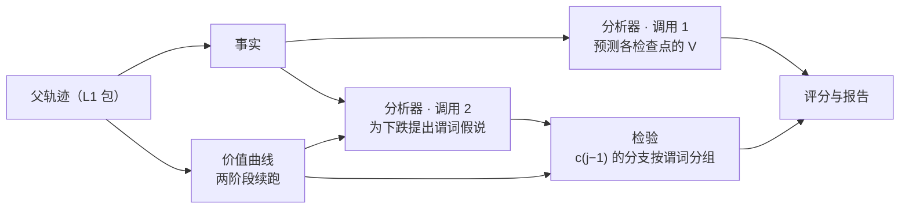

<callout icon="📐" color="blue_bg">
	**一句话：**L2 用续跑测出价值曲线，分析器预测它、用行为谓词解释它的下跌，再用同一批续跑给预测和解释打分。程序负责事实、实验和统计；LLM 只是可替换的分析器之一，赢过规则才保留。
	**与 v0.2.1 的关系：**本页取代 <mention-page url="https://app.notion.com/p/73bea7ad0cee4a03acc46d307e6d0751"/> 的 L2 部分。其中 6.1 的 L1 修复（系统提示截断、显式重试、T = 1 配置）不变，是本页的前提；曲线参数沿用其 3.4 节的模拟。
</callout>
<table_of_contents color="gray"/>
---
## 一、四条原理
1. **被诊断的是策略 π。**模型、解码参数、系统提示、工具、预算全程固定，且 T = 1：没有采样，就没有「另一种做法」可比。
2. **唯一的真值是检查点价值** $`V(c_k)=\mathbb{E}[Y\mid \pi\ \text{从}\ c_k\ \text{续跑}]`$。L1 冷恢复让它可以直接测：从 $`c_k`$ 续跑 N 次，用官方评分器打分，取平均。不需要人工标注。
3. **每个解释都是关于 V 的预测。**「在哪」预测曲线在哪一段下跌；「为什么」预测：从 $`c_{j-1}`$ 重新采样第 j 回合时，满足某个行为谓词 P 的分支结果更差。写不成程序能判定的谓词，就不可检验。
4. **分析器的价值 = 被实验证实的预测 − 成本。**规则分析器是基线；LLM 只有在同样信息下赢过它才保留。
由此，L2 只有一个循环：**程序给事实 → 分析器下注 → 续跑开奖**。不服务于这个循环的结构都删掉（第六节）。
<callout icon="💡" color="gray_bg">
	**怎么读曲线：**续跑测的是 π 自己的平均水平，所以第 j 回合的下跌 $`d_j=V(c_{j-1})-V(c_j)`$ 量的是「父轨迹这一回合比 π 在同一状态下的平均动作差多少」。π 一贯的弱点（几乎每次都这样做）不会表现为某处下跌，而是让 $`V(c_0)`$ 从一开始就低（`out_of_reach`）。前者由 L2 解释，后者交给 L3。
</callout>
---
## 二、一个循环，四个部分

<table header-row="true">
<tr>
<td>**部分**</td>
<td>**谁做**</td>
<td>**输入**</td>
<td>**输出**</td>
</tr>
<tr>
<td>事实</td>
<td>程序</td>
<td>任一 L1 包（父轨迹或分支）</td>
<td>每回合的事实 `{turn, type, value}`</td>
</tr>
<tr>
<td>分析器</td>
<td>规则（必有）、LLM（可选）</td>
<td>父轨迹、事实、任务基线 $`p_0`$；调用 2 另加曲线摘要</td>
<td>价值预测；谓词假说</td>
</tr>
<tr>
<td>价值曲线</td>
<td>程序调用 L1 续跑</td>
<td>父轨迹</td>
<td>各检查点的 $`\hat V`$、判定、定位到的回合或区间</td>
</tr>
<tr>
<td>检验</td>
<td>程序</td>
<td>分支结果、分支在第 j 回合的事实</td>
<td>预测得分、假说状态与效应</td>
</tr>
</table>
- **两种模式，一份合同。**Program-only 只有规则分析器；Hybrid 再加 LLM 分析器。实际使用时，Hybrid 只在「已定位、但规则谓词都没证实」的下跌上调用 LLM；评测时对全部轨迹调用。
- **信息边界只有一条：**分析器读不到任何分支级结果（哪条分支做了什么、得了几分）。这由输入构造保证：分析器的输入函数只接受父轨迹、$`p_0`$ 和曲线摘要（各检查点的 $`\hat V`$ 与判定）。
### 2.1 事实
沿用 `facts/build.py`，只改两处：每条事实加 `turn`（产生它的模型回合，从 1 开始；分支从检查点的 k 接着数）；`tool_exit` 加布尔字段 `ok`（退出码为 0，且没有超时或输出截断）。同一个函数作用于父轨迹和每个分支，所以分支在第 j 回合做了什么，可以直接用谓词判定。
### 2.2 谓词
语法只有 `all`、`any`、`not` 和原子 `{fact, where}`。原子为真，当且仅当该回合至少有一条类型为 `fact` 的事实，其字段逐一匹配 `where`：字符串支持 `*` 通配，字段名可用点号取嵌套。比较语义放进事实字段，不进语言。规则分析器的词表（v0.2.1 第四节的分层标签）就用它写成：
```json
{
  "tool_execution_anomaly":   {"fact": "tool_exit", "where": {"ok": false}},
  "submission_modified":      {"fact": "file_transition", "where": {"path": "submission/*"}},
  "assistant_finished_turn":  {"not": {"fact": "tool_requested"}},
  "submission_readback":      {"all": [
                                {"fact": "tool_requested", "where": {"name": "run", "arguments.command": "*submission*"}},
                                {"not": {"fact": "file_transition", "where": {"path": "submission/*"}}}]},
  "object_structure_changed": {"fact": "object_structure_change"}
}
```
非 docx 任务没有 `object_structure_change` 事实，这个谓词在父轨迹上恒为假，规则分析器自然不会提出它，不需要「不适用」的特殊处理。
### 2.3 分析器
```python
class Values(TypedDict):        # 调用 1：只看父轨迹
    analyst: str                # 如 "rules@1"、"llm:<模型>@<提示词 sha>"
    values: list[float]         # values[k] 是对 V(c_k) 的预测，k = 0 … T−1

class Hypothesis(TypedDict):    # 调用 2：另加曲线摘要，仍看不到分支级结果
    turn: int                   # 落在定位到的回合或区间内
    predicate: dict             # 2.2 的谓词
    effect: float               # 预测的 E[Y | P] − E[Y | ¬P]，应为负
    rationale: str              # 只展示，不参与评分
```
- 所有分析器拿到同一个 $`p_0`$：该任务 M2 基线运行的平均终点，不含父轨迹本身。
- **规则分析器**：值预测用「首个异常阶跃」，即第一个 `tool_execution_anomaly` 回合之前预测 $`p_0`$，之后预测 Y，没有异常时线性衰减；假说是父轨迹在定位回合上满足的全部词表谓词。
- **LLM 分析器**：同样两次调用，输出同样两个类型；提示词只在训练家族上调。
- 只对 `concentrated_*` 判定做调用 2。
---
## 三、价值曲线
```python
def curve(parent, N1=12, N2=24, stride=4, alpha=0.05):
    T, Y = parent.turns, parent.outcome                        # c_T 是终态，价值就是 Y
    grid = [*range(0, T, stride), T]                           # 网格与分析器无关
    s1 = {k: resume(parent, k, N1) for k in grid[:-1]}          # 第一阶段：只用来选区间
    if upper(s1[0], alpha) < 0.25:
        return Verdict('out_of_reach')
    v1 = {k: mean(s) for k, s in s1.items()} | {T: Y}
    a, b = max(pairwise(grid), key=lambda ab: v1[ab[0]] - v1[ab[1]])    # 并列取最早
    s2 = {k: resume(parent, k, N2) for k in range(a, b + 1) if k < T}   # 第二阶段：全新样本，推断只用它
    j = max(range(a + 1, b + 1), key=lambda t: drop(s2, t - 1, t))
    if lower(drop(s2, j - 1, j), alpha / (b - a)) > max(0.10, 2 * (v1[0] - Y) / T):
        return Verdict('concentrated_turn', turn=j)
    if lower(drop(s2, a, b), alpha) > (b - a) / T * (v1[0] - Y):       # 超过均匀摊派应有的份额
        return Verdict('concentrated_interval', interval=(a, b))
    return Verdict('diffuse_loss', interval=(a, b))
```
`lower` / `upper` 是单侧置信界：布尔终点用 Newcombe 区间，有界得分用 bootstrap；端点是终态时按单样本处理。
<table header-row="true">
<tr>
<td>**判定**</td>
<td>**含义**</td>
</tr>
<tr>
<td>`concentrated_turn`</td>
<td>损失集中在第 j 回合</td>
</tr>
<tr>
<td>`concentrated_interval`</td>
<td>损失集中在区间 (a, b\]，单回合分不开</td>
</tr>
<tr>
<td>`diffuse_loss`</td>
<td>没有检出集中下跌</td>
</tr>
<tr>
<td>`out_of_reach`</td>
<td>$`V(c_0)`$ 从一开始就低，没有可定位的损失</td>
</tr>
</table>
- 失败轨迹的实际路径每一步都略差于平均，所以零假设是「损失均匀摊派」，不是「没有下跌」。
- 只分析失败轨迹（OfficeVal dim1 未通过、LHTB 未通关）。参数沿用 v0.2.1 的模拟：T = 16 时每条轨迹约 165 个分支；骤降 0.5 时单回合检出率 0.74；只有均匀损失时，区间误报约 6%。M3 实测方差后复核 N1、N2。
### 3.1 一个分支的结果
**策略造成的结果都记分，基础设施造成的都重跑。**
<table header-row="true">
<tr>
<td>**情形**</td>
<td>**y**</td>
</tr>
<tr>
<td>执行有效，评分器正常返回</td>
<td>L1 的评分投影：OfficeVal 取 `completion_rate`，LHTB 取 `passed`</td>
</tr>
<tr>
<td>执行有效，但交付为空，或评分状态不是 ok</td>
<td>0</td>
</tr>
<tr>
<td>执行无效（重试后仍传输失败、中断），或评分器异常</td>
<td>无效，换新编号重跑</td>
</tr>
</table>
一条轨迹的无效率超过 5% 就整条剔除，并在报告里列出。
### 3.2 执行
- 分支就是一次 L1 冷恢复，目录 `branches/<trial>/`（如 `k008-s2-i17`）本身是一个 L1 包。已有有效结果的分支跳过，所以重跑命令就是续跑，不需要执行日志和状态机。
- 同一阶段的全部分支按固定种子打乱后提交，避免 API 漂移混进 $`\Delta V`$；线程池并发 4–8，全局令牌桶限流。
- 不带 `--execute` 时只写 `plan.json`，打印分支数和成本估计，不花钱。
- 每个分支记录 `modelVersion`，只记录，不中止。
---
## 四、解释的检验
对假说 (j, P, e)：
1. **一致**：P 在父轨迹第 j 回合必须为真，否则记 `inconsistent`（它解释的不是父轨迹做过的事）。
2. **分组**：取 $`c_{j-1}`$ 的第二阶段分支（各自重新采样了第 j 回合），按分支第 j 回合的事实是否满足 P 分成两组；任一组少于 4 条，记 `untestable`。
3. **检验**：单侧置换检验（布尔终点用 Fisher 精确检验），零假设是两组结果同分布。同一分析器在同一轨迹上的假说做 Holm 校正；通过且方向与 e 一致记 `confirmed`，否则记 `not_confirmed`。
4. **报告**：P 在分支中的频率 $`\hat f`$，效应 $`\hat\Delta_P=\bar Y_P-\bar Y_{\neg P}`$，以及解释份额 $`(1-\hat f)\,\lvert\hat\Delta_P\rvert/\hat d_j`$，即 P 能解释第 j 回合下跌的比例（恒等式 $`\hat V(c_{j-1})-\bar Y_P=(1-\hat f)\,\lvert\hat\Delta_P\rvert`$）。只有 π 少做（f 小）而且很伤（\|Δ\| 大）的行为，才能解释一次集中下跌。
**为什么这样就够了：**
- **没有混杂**：给定完整状态，第 j 回合的动作只由 π 自己采样。所以 $`\Delta_P`$ 是「第 j 回合取 P 类动作 vs 非 P 类动作、之后照常执行」的因果差。它不等于「P 本身导致失败」，因为 P 类动作在别的方面也可能不同；那要靠干预。
- **不需要再拆样本**：第 j 回合是用这批分支选出来的，但选择只依赖各检查点的结果均值，谓词只依赖父轨迹和曲线摘要，两者都不随「哪条分支得了哪个分数」而变，所以置换检验仍然精确。
- **跨轨迹合并**：同一个词表谓词以轨迹为层合并（布尔终点用 Mantel–Haenszel）；区间按任务家族做聚类 bootstrap。
<table header-row="true">
<tr>
<td>**证据等级**</td>
<td>**来源**</td>
<td>**能说什么**</td>
</tr>
<tr>
<td>E0</td>
<td>事实、未检验的预测</td>
<td>发生了什么；分析器怎么看</td>
</tr>
<tr>
<td>E1</td>
<td>曲线判定</td>
<td>损失发生在哪个回合或区间</td>
</tr>
<tr>
<td>E1+</td>
<td>假说 `confirmed`</td>
<td>在这个状态下，做 P 类动作的结果更差</td>
</tr>
<tr>
<td>E2（之后）</td>
<td>干预，需要 L1 注入接口</td>
<td>P 本身导致失败</td>
</tr>
</table>
---
## 五、评分与研究问题
**价值预测**直接用分支结果打分。分支结果 $`y_i`$ 从 $`V(c_k)`$ 抽出，所以
$$
\mathbb{E}\big[(p-y_i)^2\big]=\big(p-V(c_k)\big)^2+\operatorname{Var}(y\mid c_k)
$$
第二项与预测无关：两个分析器的 Brier 之差，就是它们离真实 V 的平方误差之差的无偏估计。每个有分支的检查点等权；两阶段的网格都与分析器无关，所以对谁都公平。
<table header-row="true">
<tr>
<td>**指标**</td>
<td>**定义**</td>
<td>**回答**</td>
</tr>
<tr>
<td>技能分</td>
<td>1 − Brier(分析器) / Brier(线性衰减 $`p_0 \to Y`$)</td>
<td>「在哪」预测得准不准</td>
</tr>
<tr>
<td>证实率</td>
<td>`confirmed` 数 / 提出的假说数</td>
<td>解释靠不靠谱</td>
</tr>
<tr>
<td>解释覆盖</td>
<td>集中下跌中，至少一条假说 `confirmed` 且解释份额 ≥ 0.5 的比例</td>
<td>能不能把下跌讲清楚</td>
</tr>
<tr>
<td>成本</td>
<td>分析器费用折合多少次续跑</td>
<td>值不值</td>
</tr>
</table>
**对比组**（都拿到 $`p_0`$ 和调用 2 的曲线摘要，都看不到分支级结果）：
<table header-row="true">
<tr>
<td>**组**</td>
<td>**分析器**</td>
<td>**额外输入**</td>
<td>**回答**</td>
</tr>
<tr>
<td>A</td>
<td>规则</td>
<td>事实</td>
<td>程序能做到多少</td>
</tr>
<tr>
<td>B</td>
<td>LLM</td>
<td>原始轨迹</td>
<td>裸 LLM 能做到多少</td>
</tr>
<tr>
<td>C</td>
<td>LLM</td>
<td>原始轨迹和事实</td>
<td>事实层对 LLM 有没有用（C 对 B）；LLM 值不值（C 对 A）</td>
</tr>
<tr>
<td>R（参照）</td>
<td>规则</td>
<td>事实，以及每个检查点交付快照的官方评分</td>
<td>更好的事实最多能带来多少；不进入其他组</td>
</tr>
</table>
- 提示词只在训练家族上调，结果只报告留出家族；区间按任务家族聚类 bootstrap。
- **可证伪**：如果留出家族上 C 的技能分和解释覆盖都不显著优于 A，默认流程就是 Program-only，LLM 只保留为可选项。
---
## 六、刻意不做
<table header-row="true">
<tr>
<td>**删掉的结构**</td>
<td>**现有代码**</td>
<td>**为什么不需要**</td>
</tr>
<tr>
<td>证据引用与声明校验：事实的 10 个必填字段、假说的 12 个必填字段（supporting / counterevidence、alternatives、assumptions……）</td>
<td>`evidence/references.py`、`validation.py`、`contracts.json`</td>
<td>假说由实验检验，不由引用检验；rationale 只展示。程序只查一件事：谓词在父轨迹上为真</td>
</tr>
<tr>
<td>定位类别枚举（9 类）和粒度枚举</td>
<td>`contracts.json`</td>
<td>「在哪」由曲线回答，「是什么」由谓词回答</td>
</tr>
<tr>
<td>封印、清单、索引、trust_scope、四种 package_kind、打包与解包</td>
<td>`package.py`、`portable.py`</td>
<td>L1 包已经封存证据；L2 的输出都是输入的纯函数，记录输入哈希和代码版本，重算即验证</td>
</tr>
<tr>
<td>授权文件、执行日志、回执、计划与授权的一致性检查</td>
<td>`experiments/controller.py`、`io.py`</td>
<td>唯一的副作用是花钱，用一个 `--execute` 开关；分支目录就是状态</td>
</tr>
<tr>
<td>预测冻结清单与承诺哈希</td>
<td>`pipeline.py`、`experiments/plans.py`</td>
<td>分析器在输入层面就读不到分支结果，不靠时间顺序和哈希</td>
</tr>
<tr>
<td>缺失结果的上下界、敏感性分析、补跑上限、`not_identifiable`</td>
<td>v0.2.1 第 3.3、3.5 节</td>
<td>基础设施失败就重跑；无效率超过 5% 剔除整条轨迹</td>
</tr>
<tr>
<td>每个分支的首请求逐字节比对、modelVersion 变化即中止</td>
<td>v0.2.1 第 3.5 节</td>
<td>首请求一致性是 L1 的性质：一个 L1 测试，加 M1 一次抽查；modelVersion 只记录</td>
</tr>
<tr>
<td>独立的分层流程</td>
<td>v0.2.1 第四节</td>
<td>分层标签就是规则分析器的谓词词表，和 LLM 假说走同一个检验</td>
</tr>
</table>
---
## 七、实现
### 7.1 目录与命令
```javascript
l2/<episode_id>/
├─ facts.jsonl                  父轨迹的事实
├─ values/<analyst>.json        调用 1
├─ plan.json                    网格、N1、N2、种子、成本估计
├─ branches/<trial>/            L1 包，原样保留
├─ outcomes.jsonl               每个分支一行：k、阶段、是否有效、y、modelVersion
├─ curve.json                   各检查点的 V̂ 与判定
├─ hypotheses/<analyst>.json    调用 2
├─ scores.json                  价值预测得分、每条假说的检验结果
└─ report.md
```
每个 JSON 文件开头记录输入文件的 sha256 和代码版本；分析器输出按输入哈希缓存。
```bash
l2 run <l1_run> --analysts rules,llm:<config> [--execute]   # 全流程，幂等
l2 summarize <l2_dir>...                                    # 跨轨迹评分与合并
```
### 7.2 现有代码怎么改
现有 L2 代码 2,200 行，另有 696 行的 `contracts.json`，测试 68 个。
<table header-row="true">
<tr>
<td>**现有**</td>
<td>**行数**</td>
<td>**处理**</td>
</tr>
<tr>
<td>`facts/build.py`、`facts/docx_probe.py`</td>
<td>191、99</td>
<td>保留；加 `turn` 和 `tool_exit.ok`，去掉引用、覆盖、来源字段</td>
</tr>
<tr>
<td>`evidence/l1.py`</td>
<td>316</td>
<td>只保留读取：事件、检查点、评分投影</td>
</tr>
<tr>
<td>`evidence/view.py`</td>
<td>96</td>
<td>保留，作为 LLM 的轨迹视图</td>
</tr>
<tr>
<td>`analyst/backend.py`、`analyst/run.py`</td>
<td>59、109</td>
<td>合并为 `analysts/llm.py`：两次调用，输出 2.3 的两个类型</td>
</tr>
<tr>
<td>`analyst/rules.py`</td>
<td>79</td>
<td>改为规则分析器：首个异常阶跃和谓词词表</td>
</tr>
<tr>
<td>`experiments/plans.py`、`experiments/controller.py`</td>
<td>107、161</td>
<td>合并为 `curve.py`：网格、两阶段、并发、重跑、判定</td>
</tr>
<tr>
<td>`evaluation/metrics.py`</td>
<td>49</td>
<td>扩为 `score.py`：Brier 技能分、证实率、解释覆盖</td>
</tr>
<tr>
<td>新增</td>
<td>—</td>
<td>`predicates.py`（解析与求值，约 40 行）；`stats.py`（置信界、置换与 Fisher 检验、Holm、Mantel–Haenszel、聚类 bootstrap）</td>
</tr>
<tr>
<td>`package.py`、`portable.py`、`evidence/references.py`、`validation.py`、`schemas/contracts.json`</td>
<td>233、57、90、70、696</td>
<td>删除；输出类型直接用 TypedDict</td>
</tr>
<tr>
<td>`io.py`</td>
<td>170</td>
<td>只留 JSON / JSONL 读写和哈希</td>
</tr>
<tr>
<td>`pipeline.py`、`cli.py`、`config.py`、`reporting.py`</td>
<td>104、95、71、34</td>
<td>合并为 `cli.py`（两个命令）和 `report.py`；保留「配置里不许写密钥」的检查</td>
</tr>
</table>
**测试**：删掉 `test_integrity` 里封印和授权相关的部分；新增五类：谓词求值；统计检验在零假设下的误报率（复用 v0.2.1 的模拟脚本）；曲线（用假的 `resume`）；信息边界（分析器输入里没有任何分支级结果）；幂等续跑（已完成的分支不重跑）。
---
## 八、里程碑
<table header-row="true">
<tr>
<td>**阶段**</td>
<td>**内容**</td>
<td>**验收**</td>
</tr>
<tr>
<td>M0</td>
<td>L1 前置修复和 T = 1 配置（v0.2.1 第 6.1 节）</td>
<td>进行中</td>
</tr>
<tr>
<td>M1</td>
<td>Program-only 跑通：3 个 OfficeVal 任务和 1 个 LHTB sokoban 任务</td>
<td>评分器确定（同一交付评 3 次一致）；首请求一致性测试通过；墙钟到期 \< 1%；无效率 \< 5%</td>
</tr>
<tr>
<td>M2</td>
<td>基线：20–30 个任务家族，每个 5 次</td>
<td>得到 $`p_0`$ 和失败轨迹池</td>
</tr>
<tr>
<td>M3</td>
<td>≥ 40 条失败轨迹的曲线和规则假说（Program-only）</td>
<td>实测方差，复核 N1、N2</td>
</tr>
<tr>
<td>M4</td>
<td>A / B / C / R 对比</td>
<td>在留出家族上按第五节的判据下结论</td>
</tr>
</table>