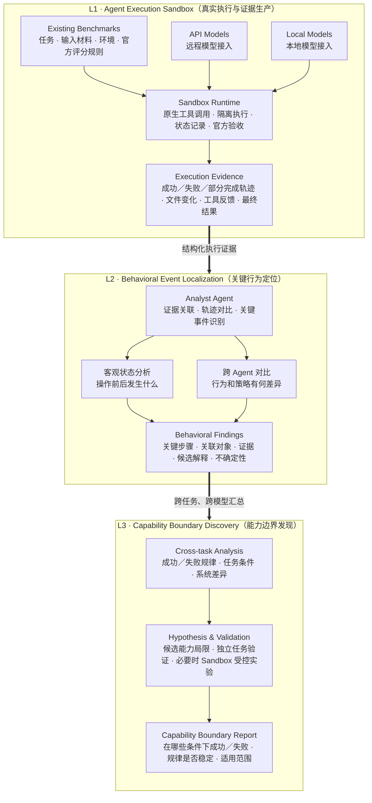

# Agent 行为诊断与能力边界发现：整体研究架构

> **核心目标**：利用现有 Benchmark 提供真实任务，通过 Sandbox 生产客观执行证据，再由 Analyst 定位关键行为问题，最终发现 Agent 在不同任务与环境条件下的能力边界。

---

## 一、完整三层架构图

### 架构层级流转说明

1. **L1 · Agent Execution Sandbox（真实执行与证据生产）**
   - **Existing Benchmarks**：任务、输入材料、环境依赖、官方评分规则。
   - **模型接入**：支持 API 远程模型与本地开源模型。
   - **Sandbox Runtime**：原生工具调用、隔离沙箱执行、全生命周期状态记录、官方严格验收。
   - **产出 Execution Evidence**：成功／失败／部分完成轨迹、文件差异变化（Diff）、工具调用及系统返回、最终评测结果。

2. **L2 · Behavioral Event Localization（关键行为定位）**
   - **Analyst Agent**：负责客观证据关联、执行轨迹对比与关键异常事件识别。
   - **双轨分析机制**：
     - *客观状态分析*：严格比对操作前后环境发生了什么事实变化。
     - *跨 Agent 对比*：比对不同模型在相同任务/步骤下的行为决策与策略差异。
   - **产出 Behavioral Findings**：定位关键步骤、关联影响对象、锚定确凿证据、提出候选解释并标注置信度/不确定性。

3. **L3 · Capability Boundary Discovery（能力边界发现）**
   - **Cross-task Analysis**：跨任务多样本汇总成功/失败规律、任务敏感条件、系统架构差异。
   - **Hypothesis & Validation**：提炼候选能力局限假设，在独立新任务中检验，必要时通过 Sandbox 受控分支实验进行反事实验证。
   - **产出 Capability Boundary Report**：明确 Agent 在哪些特定条件下成功或失败、规律是否可重复稳定、以及具体的能力适用边界。

---

## 二、三层的核心分工

| 层次 | 核心问题 | 负责什么 | 最终产物 |
| :--- | :--- | :--- | :--- |
| **L1：执行环境** | Agent 实际做了什么？ | 接入现有任务、运行 Agent、记录执行过程和验收结果 | **可信执行轨迹与状态证据** |
| **L2：行为定位** | 哪些关键行为与结果有关？ | 关联工具、对象、状态变化和跨模型差异 | **有证据的行为定位报告** |
| **L3：能力边界** | Agent 在什么条件下容易成功或失败？ | 汇总多任务规律、提出并验证条件性限制 | **能力边界与适用条件报告** |

---

## 三、三个必须保持的设计原则

1. **原则一：Benchmark 只是任务来源**  
   我们复用现有 Benchmark 的成熟任务、沙箱环境和评估器，**不重新建设大型题库**，也不把 Benchmark 设计作为本研究的核心创新点。
2. **原则二：Sandbox 与 Analyst 严格分离**  
   Sandbox 负责真实执行、客观证据采集、必要的检查点分支与受控重放；Analyst 可以使用 LLM 进行推理，但仅负责分析与解释，**绝对不允许自行篡改执行结果或官方评分**。
3. **原则三：观察事实、候选解释、验证结论必须严格分开**  
   - *观察事实*：如“第 7 步覆盖了公式”，由环境状态与文件变化直接客观证明；
   - *候选解释*：如“模型可能缺乏全局结构理解能力”，属于待验证假说，需要额外证据支持；
   - **铁律**：单次成功或失败绝不能直接草率推出稳定的能力缺陷结论。

---

## 四、目前项目进度

| 部分 | 当前状态 | 详细说明 |
| :--- | :--- | :--- |
| **真实任务与 Docker 环境** | ✅ 已有实际运行 | 沙箱隔离与基础运行环境已跑通 |
| **API 模型接入** | ✅ 已有真实记录 | Gemini 等商业 API 已有真实多轮工具调用记录 |
| **本地模型接入** | 🟡 部分实现 | 已有实现与部分运行证据，统一接入管线仍待核验收敛 |
| **轨迹、状态、官方评分** | 🟡 已有基础 | 基础数据结构具备，记录的完整性与细粒度仍需完善 |
| **检查点与受控分支** | 🟡 部分验证 | 已有部分真实验证，机制正在持续打磨 |
| **Analyst 关键行为定位** | 🔄 原型阶段 | 已有分析组件原型，尚未大规模系统验证定位准确率 |
| **跨任务能力边界发现** | ⏳ 规划阶段 | 方法框架已明确，尚未建立系统性研究结论 |

---

## 五、整个研究最终要证明什么？

* **L1：证据是否可信？**  
  执行记录能否完整、准确、无遗漏地反映 Agent 的真实行为和环境状态变化。
* **L2：定位是否准确？**  
  相比直接让通用 LLM 裸读日志文本，专职 Analyst Agent 结合客观证据能否显著更准确地定位关键行为，并精确引用确凿证据。
* **L3：规律是否可验证？**  
  所发现的条件性行为局限与能力边界，能否在独立未知任务和受控实验条件下得到稳定复现与经验支持。

---

> 💡 **核心一句话总结：**  
> **L1 让 Agent 真实执行并留下证据；L2 从证据中定位关键行为问题；L3 从多个案例中发现并验证 Agent 的能力边界。**
